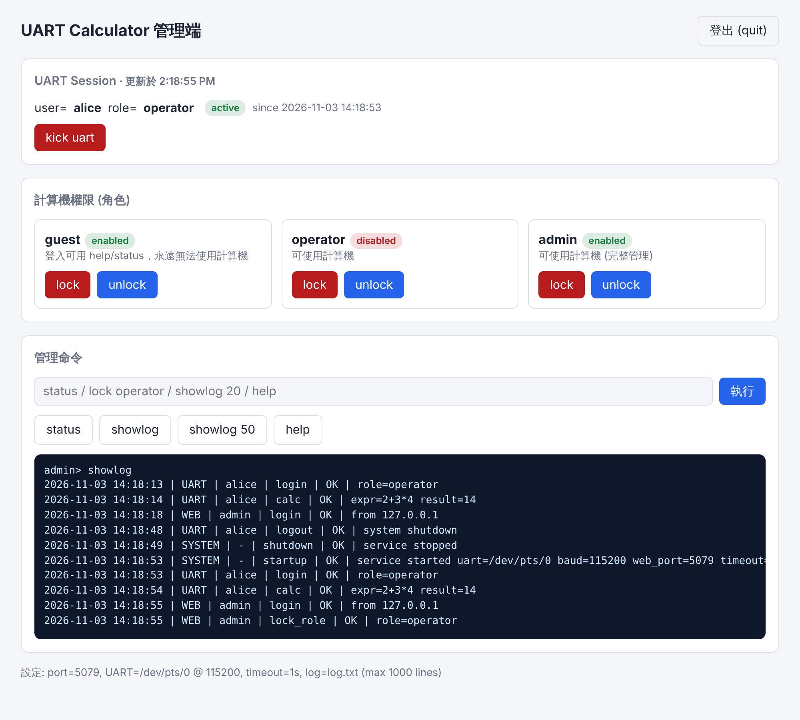

# UART 計算機系統 + 網頁管理端

在 Raspberry Pi 4 上以 C 語言實作的 UART 文字計算機，系統分成兩個介面：

- **UART 端**：使用者用 PuTTY 透過序列埠登入，進入計算機模式，支援 `+ - * /` 與括號 `()`。
- **網頁管理端**：管理者用瀏覽器開 `http://<Pi_IP>:5000/`，可以查看目前的 UART 使用者、鎖定或解鎖某個角色使用計算機、強制踢除 UART 使用者，以及查看操作日誌。

所有設定集中在 `config.txt`，所有操作都會寫入 `log.txt`。

## 角色與權限

| 角色 | 登入 | `help` / `status` | 計算機 |
|---|---|---|---|
| `guest` | 可以 | 可以 | 永遠不行 |
| `operator` | 可以 | 可以 | 可以 (網頁端可鎖定) |
| `admin` | 可以 | 可以 | 可以 (網頁端可鎖定) |

網頁管理端控制的是「哪些角色現在可以使用 UART 計算機」。角色被鎖定後，該角色的使用者仍可登入，但輸入算式會收到 `Permission denied`。

## 目錄結構

```
uart_calc/
├── Makefile          編譯與測試
├── config.txt        設定檔
├── web_admin.png     網頁管理端截圖
├── src/              程式碼 (每個模組一組 .c / .h)
└── tests/            單元測試
```

## 模組說明

### 介面層

**`main.c`：程式進入點**
- 讀取 `config.txt`，並依序初始化各模組。
- 設定 `SIGINT` / `SIGTERM` 處理，讓 `Ctrl+C` 或 `kill` 都走正常關閉流程。
- 建立 UART 與網頁兩條執行緒，等待關機訊號後回收資源，並記錄 `startup` / `shutdown` 日誌。

**`uart_session.c`：UART 使用者介面**
- 顯示 `Login:` / `Password:` 並驗證帳號。輸入密碼時不回顯，登入失敗延遲 1 秒。
- 實作簡單的行編輯器：字元回顯、Backspace、`Ctrl+C` 清除本行，並處理 PuTTY 送出的 `\r` / `\r\n`。
- 登入後進入計算機模式，處理 `help`、`status`、`quit`，其他輸入都當成算式。
- 每次計算前重新檢查角色權限，所以網頁端鎖定後立即生效。
- 讀取逾時時檢查網頁端的踢除請求，被踢除會顯示 `*** Session terminated by admin ***` 並回到登入畫面。

**`web.c`：網頁管理端**
- 自行實作的簡易 HTTP 伺服器，不依賴外部函式庫，一次處理一個連線，收送逾時 5 秒。
- 以 Cookie (`sid=` 隨機 32 字元) 管理登入，最多 8 個同時登入，閒置 30 分鐘自動登出。
- 提供以下路由：

  | 路徑 | 說明 |
  |---|---|
  | `GET /` | 未登入顯示登入頁，已登入顯示管理主頁 |
  | `POST /login` | 驗證管理密碼 |
  | `POST /cmd` | 執行管理命令，完成後重新導向回主頁，避免重新整理時重複送出 |
  | `GET /api/status` | 回傳 JSON 狀態，主頁每 2 秒自動更新 (不寫入日誌) |

- 輸出到網頁的內容都會做 HTML 跳脫，防止使用者輸入的算式造成 XSS。

### 應用層

**`calc.c`：算式求值**
- 以遞迴下降法解析，三層函式對應運算子優先順序：`expr` (加減) → `term` (乘除) → `factor` (正負號、數字、括號)。
- 支援小數與一元正負號，例如 `-3*(2+1.5)`。
- 能偵測除以 0、語法錯誤、括號不成對、數值溢位，並限制巢狀深度以防止堆疊溢位。
- 整數結果直接顯示 (`14`)，非整數最多顯示 10 位有效數字 (`3.5`)。
- 純函式，不依賴任何其他模組，可以直接在 PC 上做單元測試。

**`admin_cmd.c`：管理命令**
- 解析並執行 `status`、`lock`、`unlock`、`kick uart`、`showlog`、`help`、`quit`。
- 只處理「命令文字 → 動作 → 輸出文字」，不知道命令來自哪個介面。網頁上的按鈕和命令輸入框共用同一套邏輯；要新增其他介面 (例如 `nc` 連線的 TCP 介面) 也只要呼叫 `admin_exec()`。
- 每個命令不論成功或失敗都會寫入日誌。

### 服務層

**`state.c`：共享狀態**
- 保存 UART 與網頁兩條執行緒共用的資料：各角色是否啟用、目前的 UART 登入者、踢除請求、程式是否繼續執行。
- 所有變數都是 `static`，外部只能透過函式存取，互斥鎖在函式內部處理，呼叫者不需要自己上鎖。
- `state_snapshot()` 一次取得所有欄位的副本，保證讀到同一個時間點的一致資料。
- `kick uart` 只設定旗標，由 UART 執行緒自己結束 session，所以序列埠只會被一條執行緒存取。

**`log.c`：日誌**
- 以固定格式寫入 `log.txt`，並同時印到螢幕。
- 會把使用者輸入中的 `|` 和換行換掉，確保每行格式固定。
- 超過 `MAX_LOG_LINES` 時刪除最舊的紀錄。先寫暫存檔再 `rename`，寫到一半斷電也不會損壞原檔。
- `log_tail(n)` 讀取最後 n 行，供 `showlog` 使用。
- 內建互斥鎖，可以從任何執行緒呼叫。

**`config.c`：設定檔與帳號**
- 讀取 `config.txt`，檢查每個必要欄位是否存在、數值是否在合法範圍內。
- 解析選填的 `USERS` 欄位建立 UART 帳號表；未設定時使用預設帳號。
- `config_find_account()` 驗證 UART 登入的帳號密碼。

### 硬體層

**`uart_hal.c`：UART 硬體抽象層**
- 以 termios 設定序列埠為 8N1、無流量控制、raw 模式，並套用設定的鮑率。
- 用 `VMIN=0`、`VTIME=UART_TIMEOUT_SEC×10` 讓每次讀取最多等待設定的秒數，逾時就回到上層檢查踢除和關機請求。
- 整個程式只有這個模組直接操作序列埠。移植到 RTOS 或 MCU 時，只要用同樣的介面重寫這個檔案，例如用 `HAL_UART_Receive()` 實作 `uart_hal_getc()`。

### 工具

| 模組 | 說明 |
|---|---|
| `role.c` | 角色列舉 (`ROLE_GUEST` / `ROLE_OPERATOR` / `ROLE_ADMIN`) 與名稱轉換 |
| `util.c` | `trim()` 去除前後空白、`parse_int()` 帶範圍檢查的整數解析 |
| `strbuf.c` | 可自動變長的字串緩衝區，用來組合命令輸出、HTML、JSON；附 HTML 與 JSON 跳脫函式 |

### 模組相依關係

上層只呼叫下層，下層不依賴上層：

```
介面層   uart_session.c          web.c
            │      ╲          ╱    │
應用層      │       calc.c   admin_cmd.c
            │                ╱     │
服務層   state.c    log.c    config.c
            │
硬體層   uart_hal.c

工具     role.c  util.c  strbuf.c   (各層皆可使用)
```

## 編譯與測試

```bash
make
```
```bash
make test
```
```bash
make clean
```

- `make` 產生執行檔 `uart_calc`，中間檔放在 `build/`。修改 `.h` 時，用到它的 `.c` 會自動重新編譯。
- `make test` 編譯並執行單元測試，不需要 UART 硬體，在任何 Linux 上都能執行：
  - `tests/test_calc.c`：30 項，涵蓋運算優先順序、正負號、小數、各種錯誤輸入。
  - `tests/test_config.c`：36 項，涵蓋合法設定、缺少每一個必要欄位、不合法的數值、`USERS` 格式。
- 測試 config 時畫面上會出現 `[config] ...` 錯誤訊息，那是刻意餵入錯誤設定產生的。最後一行顯示 `passed` 即代表通過。

## 在 Raspberry Pi 4 上執行

### 1. 安裝編譯環境並下載專案

```bash
sudo apt update && sudo apt install -y build-essential git
```
```bash
git clone https://github.com/koyoming123/workfile && cd workfile/uart_calc && make
```

### 2. 啟用 UART (只需做一次)

```bash
sudo raspi-config
```

進入 `Interface Options → Serial Port`：
- 「login shell over serial?」選 **No**，否則系統的登入程式會佔用 `/dev/serial0`。
- 「serial port hardware enabled?」選 **Yes**。

```bash
sudo usermod -aG dialout $USER
```
```bash
sudo reboot
```

### 3. 接線與 PuTTY

| 樹莓派 | USB-TTL (3.3V) |
|---|---|
| Pin 6 GND | GND |
| Pin 8 GPIO14 TX | RX |
| Pin 10 GPIO15 RX | TX |

PuTTY 設定：Connection type 選 **Serial**，Speed 設 `115200`，Flow control 選 **None**。

### 4. 執行

```bash
cd ~/workfile/uart_calc && ./uart_calc
```

- **UART**：在 PuTTY 按 Enter，會出現 `Login:`。
- **網頁**：開 `http://<Pi_IP>:5000/`，密碼為 `admin123`。
- **停止**：按 `Ctrl+C`，會寫入 `shutdown` 日誌。

## config.txt

```
TCP_PORT=5000            # 網頁管理端 port
UART_DEVICE=/dev/serial0
UART_BAUD=115200
LOG_FILE=log.txt         # 必須是 log.txt
MAX_LOG_LINES=1000       # 超過時只保留最新的 N 行
ALLOW_GUEST=1            # 啟動時各角色計算機是否啟用
ALLOW_OPERATOR=1
ALLOW_ADMIN=1
ADMIN_PASSWORD=admin123  # 網頁管理端密碼
UART_TIMEOUT_SEC=1       # UART 讀取逾時 (1~25 秒)
USERS=alice:alice123:operator,bob:bob123:guest,root:root123:admin   # 選填
```

- 缺少任一必要欄位、數值不合法，或 `LOG_FILE` 不是 `log.txt`，程式會印出錯誤並以 exit code 1 結束。
- `USERS` 的格式是 `帳號:密碼:角色`，以逗號分隔。
- `UART_TIMEOUT_SEC` 決定每次 UART 讀取最多等待幾秒，所以網頁端按下 `kick uart` 後，最多經過這麼多秒 UART 使用者才會被踢出。

## UART 端

```
Login: alice
Password:
Welcome, role=operator
Calculator Ready
> 2+3*4
14
> (10-2)/4
2
> help
Input arithmetic expression with + - * / and ()
Commands: help, status, quit
> quit
bye
```

| 指令 | 說明 |
|---|---|
| 算式 | 計算並顯示結果；沒有權限時回覆 `Permission denied`，算式錯誤時回覆 `Error: ...` |
| `help` | 顯示說明 |
| `status` | 顯示自己的角色、能否使用計算機，以及各角色的啟用狀態 |
| `quit` | 登出並回到 `Login:` |

## 網頁管理端



主頁可以用按鈕操作，也可以在命令輸入框輸入以下命令：

| 命令 | 說明 |
|---|---|
| `status` | 顯示 `UART user=alice role=operator state=active` 與各角色狀態 |
| `lock <role>` / `unlock <role>` | 鎖定 / 解鎖該角色使用計算機 |
| `kick uart` | 強制中斷目前的 UART session |
| `showlog [n]` | 顯示最後 n 行日誌 (預設 10) |
| `help` | 顯示說明 |
| `quit` | 登出網頁 |

## log.txt

每行格式：

```
YYYY-MM-DD HH:MM:SS | SOURCE | USER | ACTION | RESULT | DETAIL
```

- `SOURCE`：`SYSTEM`、`UART` 或 `WEB`
- `RESULT`：`OK`、`FAIL` 或 `DENIED`

範例：

```
2026-05-25 10:00:01 | SYSTEM | - | startup | OK | service started ...
2026-05-25 10:00:10 | UART | alice | login | OK | role=operator
2026-05-25 10:00:20 | UART | alice | calc | OK | expr=2+3*4 result=14
2026-05-25 10:00:35 | WEB | admin | lock_role | OK | role=operator
2026-05-25 10:00:40 | UART | alice | calc | DENIED | expr=1+1 role locked
2026-05-25 10:01:00 | WEB | admin | kick_uart | OK | user=alice
2026-05-25 10:01:05 | UART | alice | logout | OK | kicked by admin
```

記錄的事件：

| 類別 | ACTION |
|---|---|
| 系統 | `startup`、`shutdown` |
| UART 登入 / 登出 | `login` (OK / FAIL)、`logout` (使用者離開、被踢除、系統關閉) |
| 計算 | `calc` (OK 成功、FAIL 算式錯誤、DENIED 權限拒絕) |
| UART 指令 | `help`、`status` |
| 網頁登入 / 登出 | `login` (OK / FAIL)、`logout` |
| 網頁命令 | `status`、`lock_role`、`unlock_role`、`kick_uart`、`showlog`、`help`、`command` (未知命令) |
